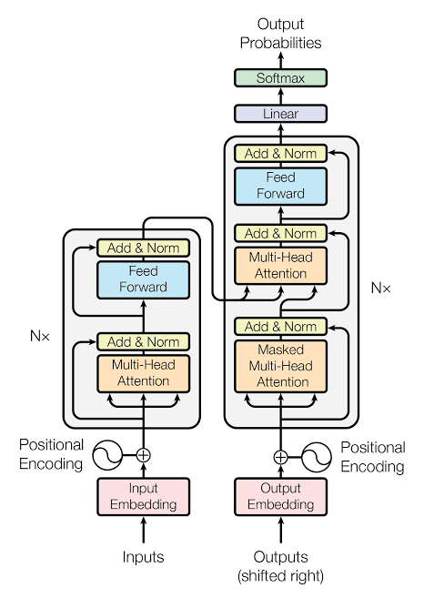

<h1 align="center">transformer</h1>


<p align="center">
  <a href="#setup"></a>
  <a href="#setup"></a>
  <a href="#architecture"></a>
  <a href="#testing"></a>
</p>


> **⚠️ Honest framing.** This is the architecture from *Attention Is All You Need*, written to be read and understood, not to be fast. The included demo model has **166,720 parameters and was trained for about 2 minutes on 2 CPU cores** to **reverse strings of digits** (`12345 → 54321`). It reaches **97 to 98% exact match** on 100 held-out strings of 2 to 8 digits. It is **not a language model** and knows nothing about English. Pure JavaScript on the CPU is slow, so anything much bigger than this will be painful. Training, resuming, saving, generating and 27 automated tests were run. **Windows, GPUs and long inputs (over 10 characters) were not tested.**


## Table of contents

1. [Setup](#setup)
2. [Using my transformer](#using-my-transformer)
3. [What is in the zip](#what-is-in-the-zip)
4. [Architecture](#architecture)
5. [Training](#training)
6. [Seeing attention](#seeing-attention)
7. [Model size and speed](#model-size-and-speed)
8. [Choosing a task](#choosing-a-task)
9. [Commands and options](#commands-and-options)
10. [Testing](#testing)
11. [Troubleshooting](#troubleshooting)


## Setup

You need **Node.js 18 or newer**. There is no `npm install` step because there are no dependencies.

```bash
# 1. install node once, from https://nodejs.org (or your package manager)
node --version        # should print v18 or higher

# 2. unzip and go into the folder
unzip transformer-js.zip
cd transformer-js

# 3. try the demo model (no training needed)
node scripts/generate.js 12345 9081726
```

| What you want | What you need |
|---|---|
| Run the demo model | Node only |
| Train your own | Node only, about 2 minutes for the default |
| Run the tests | Node only (`npm test`) |
| Use a different task | A flag, for example `--task sort` |


## Using my transformer

| Goal | Command |
|---|---|
| Generate from the demo model | `node scripts/generate.js 12345` |
| Train from scratch | `node scripts/train.js --task reverse --steps 1500 --fresh` |
| Continue training later | `node scripts/train.js --steps 500` (it loads `model/` first) |
| Train on another task | `node scripts/train.js --task sort --steps 2000 --fresh --dir model-sort` |
| Run a model from another folder | `node scripts/generate.js 31415 --dir model-sort` |
| Look inside the attention | `node scripts/show-attention.js 12345` |
| Run all tests | `npm test` |

**Things to try**

- Train `copy`, then `reverse`, then `sort`. Compare how many steps each needs to reach 95%.
- Run `show-attention.js` on the reverse model. The weights form an anti-diagonal: when it writes the first output digit it looks at the last input digit.
- Make it smaller with `--D 32 --L 1 --H 2` and see where it stops learning.
- Open `src/attention/scaled_dot_product.js`. The whole core idea is 6 lines.


## What is in the zip

Each box in the diagram has its own folder.


| File | What it is |
|---|---|
| `scripts/train.js` | Train or resume. Saves a checkpoint every 100 steps |
| `scripts/generate.js` | Run a saved model on your input |
| `scripts/show-attention.js` | Print the cross-attention table |
| `model/weights.bin` | The demo weights, raw float32, 667 KB |
| `model/config.json` | Size settings, the task, steps done, last validation loss, where each weight lives in `weights.bin` |


## Architecture


Every box in the picture is a file. Read them in this order and you have read the whole paper.

| Diagram box | File | What it does |
|---|---|---|
| Input / Output Embedding | `src/embeddings/embedding.js` | Looks up a vector per token and multiplies by √d |
| Positional Encoding | `src/positional/sinusoidal.js` | Adds fixed sine and cosine waves so the model knows the order |
| Multi-Head Attention | `src/attention/multi_head.js` | Q, K, V projections, split into heads, attend, join, project |
| Masked Multi-Head Attention | same file, with `causalMask` from `src/masks/masks.js` | Position *i* cannot see positions after *i* |
| Add & Norm | `src/addnorm/add_norm.js` | `LayerNorm(x + sublayer(x))`, post-norm as in the paper |
| Feed Forward | `src/feedforward/feed_forward.js` | `max(0, xW1+b1)W2+b2` at every position |
| Encoder, Nx | `src/encoder/` | Attention, Add & Norm, Feed Forward, Add & Norm, repeated |
| Decoder, Nx | `src/decoder/` | Masked attention, cross-attention over the encoder output, Feed Forward, each followed by Add & Norm |
| Linear | `src/output/output_head.js` | Re-uses the embedding table (weight tying) to score every token |
| Softmax | `src/output/output_head.js` | Turns scores into probabilities. During training it is folded into `crossEntropy` |
| Outputs (shifted right) | `scripts/train.js` | The decoder input is `[BOS, ...target]`, the expected output is `[...target, EOS]` |

| Part | Choice |
|---|---|
| Model | Encoder-decoder, sinusoidal positions, post-layer-norm, ReLU, tied embeddings |
| Tokenizer | Character level. Ids 0, 1, 2 are `PAD`, `BOS`, `EOS` |
| Autograd | Reverse-mode, 2-D tensors, every op has a hand-written backward pass |
| Training | Adam (β2 = 0.98), warm-up then 1/√step decay, gradient clipping at 1.0 |
| Inference | Encoder runs once, decoder generates one token at a time. Greedy or temperature plus top-k |
| Weights format | Raw float32 plus a JSON layout file (no code is ever loaded from a checkpoint) |
| Dependencies | None |

**How the autograd works.** Each op in `src/autograd/ops.js` builds the output tensor and stores a small function that sends gradients back to its inputs. `loss.backward()` sorts the graph and runs those functions in reverse. Every one of them is checked against finite differences in `tests/`.

**Simplifications.** One sequence is processed at a time, so no batch dimension. A batch is a loop whose gradients add up. There is no dropout and no label smoothing, which the paper used for large-scale training.


## Training

| Step | What happens |
|---|---|
| 1 | Loads `model/` if it exists, otherwise builds a fresh model (`--fresh` forces this) |
| 2 | Makes random examples of the chosen task on the fly, so there is no dataset to overfit |
| 3 | Each step: run `--B` examples, add up gradients, clip, take one Adam step |
| 4 | Every 100 steps: validation loss and exact match on 100 fixed held-out examples, then a checkpoint is written |
| 5 | At the end it prints 5 sample inputs with the model's answers |

Real output of the demo run:

```
task=reverse  params=166,720  D=64 layers=2 heads=4 ff=128
step   300 | train loss 0.4498 | val loss 0.3977 | exact match 50%
step   600 | train loss 0.1557 | val loss 0.0878 | exact match 86%
step  1100 | train loss 0.0515 | val loss 0.0211 | exact match 98%
step  1500 | train loss 0.0330 | val loss 0.0136 | exact match 97%
```

When you **resume**, the weights carry over but the optimiser state starts fresh, and the learning rate continues from the saved step count. In testing, a 100-step resume took exact match from 97% to 98%. The `reverse` run above took 125 seconds.


## Seeing attention

`node scripts/show-attention.js 12345` prints how much each output step looks at each input character (last decoder layer, averaged over heads):

```
input : 12345
output: 54321

          1    2    3    4    5
  in:BOS  0.00  0.00  0.00  0.01  0.99
  in:5    0.00  0.00  0.04  0.63  0.33
  in:4    0.00  0.01  0.65  0.25  0.09
  in:3    0.08  0.78  0.09  0.05  0.00
  in:2    0.87  0.12  0.00  0.00  0.00
  in:1    0.78  0.22  0.00  0.00  0.00
```

Each row is a decoder step. To write the first `5` it reads the last input digit, the next row moves one place left, and so on. Nobody told it to do this. It found the anti-diagonal by gradient descent.


## Model size and speed

Numbers measured for the demo model on 2 CPU cores.

| Setting | Value |
|---|---|
| Parameters | 166,720 (D=64, 2 layers, 4 heads, FF=128, vocab 13) |
| Weights on disk | 667 KB |
| Training speed | about 2,100 tokens/sec |
| Training run | 1,500 steps, batch 16, 125 seconds |
| Validation | 97% exact match, loss 0.014 |

The model size is fixed at the first run. To change it, use `--fresh` (or a new `--dir`):

| Size | Flags | Note |
|---|---|---|
| Tiny | `--D 32 --L 1 --H 2 --ff 64` | 21,408 params. 400 steps of `copy` took 6 seconds and reached 77% |
| Default | `--D 64 --L 2 --H 4 --ff 128` | The demo |
| Larger | `--D 128 --L 3 --H 8 --ff 256` | Estimated 4 to 5 times slower, not tested |

`--D` must be divisible by `--H`, and `--D` must be even.

Knowledge comes from **parameters and data**. A 166K model will learn a rule like "reverse" but cannot learn a language.


## Choosing a task

| Task | Example | What it tests |
|---|---|---|
| `copy` | `123 → 123` | The easiest warm-up |
| `reverse` | `123 → 321` | Needs positions, so tests positional encoding and cross-attention |
| `sort` | `3141 → 1134` | The encoder must compare every token with every other. 600 steps reached 83% in testing |

Tasks live in `src/data/tasks.js`. To add one, write a function from a string to a string and add it to the `transforms` table. `--alphabet` changes the characters (default `0123456789`), and `--minLen` / `--maxLen` change the lengths (default 2 and 8).

The model can only be asked about lengths it has seen. Trying much longer inputs than `--maxLen` will fail or give wrong answers.


## Commands and options

| Option (`train`) | Default | Meaning |
|---|---|---|
| `--task` | `reverse` | `copy`, `reverse` or `sort` |
| `--steps` | 1500 | Training steps this run |
| `--dir` | `model` | Folder to load from and save to |
| `--fresh` | off | Ignore any existing model |
| `--B` | 16 | Examples per step |
| `--D` `--L` `--H` `--ff` | 64 / 2 / 4 / 128 | Width, layers, heads, feed-forward size (first run only) |
| `--alphabet` | `0123456789` | Characters used (first run only) |
| `--minLen` / `--maxLen` | 2 / 8 | Length range of the examples |
| `--lr` | 0.003 | Peak learning rate |
| `--warmup` | 150 | Steps of learning-rate warm-up |
| `--clip` | 1.0 | Gradient-norm limit |
| `--evalEvery` | 100 | Steps between validation and checkpoint |
| `--evalSamples` | 100 | Held-out examples used for validation |
| `--seed` | 1 | Random seed, same seed gives the same run |

| Option (`generate`) | Default | Meaning |
|---|---|---|
| (first arguments) | none | One or more input strings |
| `--dir` | `model` | Which model to load |
| `--temp` | 0 | 0 always picks the top token. Higher is more random |
| `--seed` | clock | Fix it to repeat the same output |


## Testing

`npm test` runs 27 tests in under a second. Checked while building:

| Area | Covered |
|---|---|
| Every op | Forward values, and the backward pass against numerical finite differences |
| Softmax | Rows sum to 1, masked keys get exactly 0, a fully masked row gives zeros and no NaN |
| Layer norm | Zero mean and unit variance per row, correct gradient |
| Embedding | Repeated ids add up their gradients, out-of-range ids throw |
| Positional encoding | Known sin/cos values, too-long input throws |
| Attention | Weights are a distribution, padded keys get exactly 0, heads are separate |
| Whole model | Output shapes, parameter count matches a hand-computed number, tied embedding counted once |
| Causality | Changing a later decoder input leaves earlier outputs unchanged |
| Cross-attention | Changing the source changes the decoder output |
| Full-model gradient | Six weights from the encoder, decoder and embedding checked against finite differences |
| Training | 40 Adam steps cut the loss on a fixed example to under 20% |
| Checkpoint | Save then load reproduces the logits (float32 rounding only) |
| Generation | Stops at EOS or the length limit, greedy output is repeatable |
| End to end | Fresh training, resume, `generate.js` and `show-attention.js` all ran |
| Windows, GPU | **Not tested** |


## Troubleshooting

| Problem | Fix |
|---|---|
| `node: command not found` | Install Node.js 18 or newer |
| `Cannot use import statement` | Run from the project folder so `package.json` (`"type": "module"`) is found |
| `npm test` finds nothing | Use Node 18 or newer. The script is `node --test tests/*.test.js` |
| `character "x" is not in the alphabet` | The model only knows the characters it was trained on (see `alphabet` in `model/config.json`) |
| `sequence length N is longer than maxLen` | The model was built for short sequences. Train with a larger `--maxLen` and `--fresh` |
| Output is wrong on long inputs | Expected. It never saw lengths above `--maxLen` |
| Exact match stuck low | Train more steps, or lower `--lr` to 0.002 |
| Training is slow | Use fewer steps or a smaller `--D`/`--L`. Pure JavaScript has no GPU path |
| Want to change model size | Add `--fresh` (or a new `--dir`). Size is fixed once a model exists |
| `unknown option` | Options are exact. See [Commands and options](#commands-and-options) |
